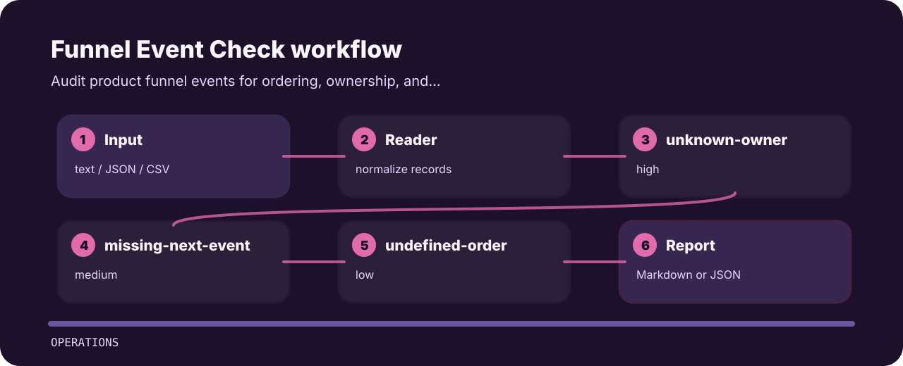

# Funnel Event Check

Audit product funnel events for ordering, ownership, and conversion gaps.


## Finding map



## Decision points

- `unknown-owner` - event owner missing (high); assign analytics owner.
- `missing-next-event` - next funnel event missing (medium); define funnel transition.
- `undefined-order` - event order missing (low); number funnel stages.

## Files to open first

```text
.github/        CI workflow
examples/       sample inputs
src/            package source
tests/          test coverage
```

## Fresh clone path

```bash
git clone https://github.com/mertefekurt/funnel-event-check.git
cd funnel-event-check
python -m pip install -e ".[dev]"
funnel-event-check examples/sample.txt
```
